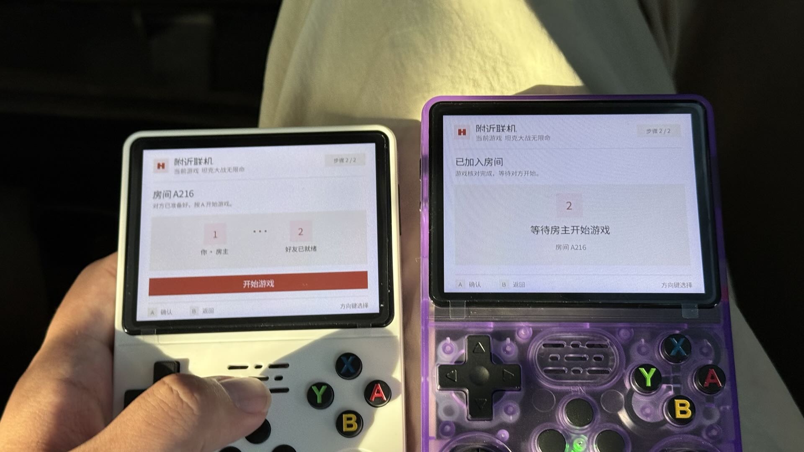
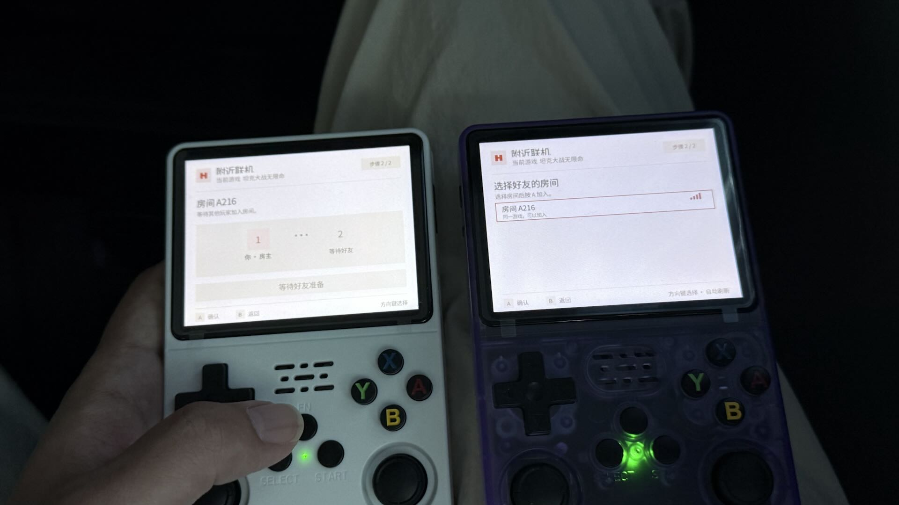
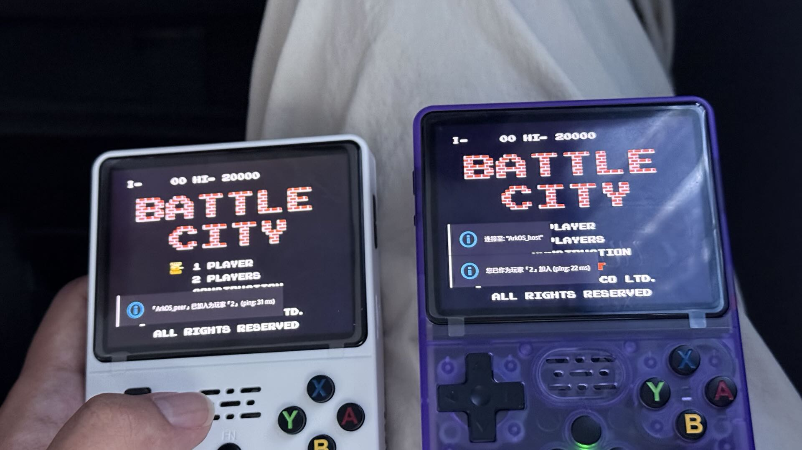
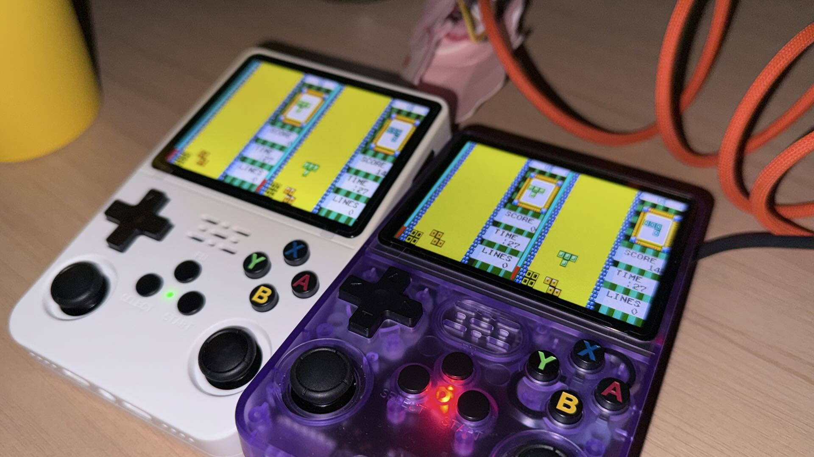
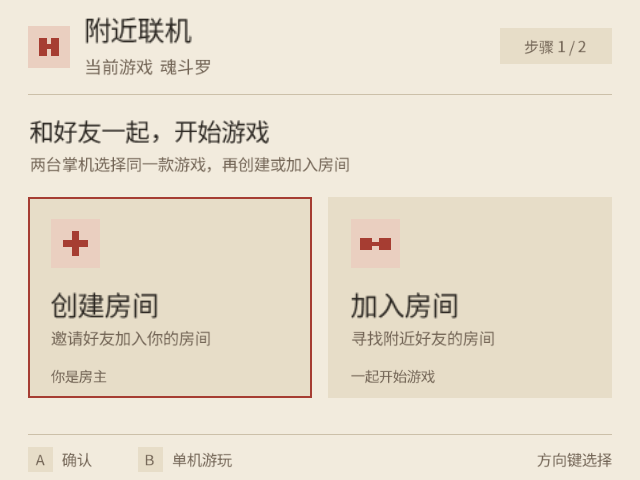
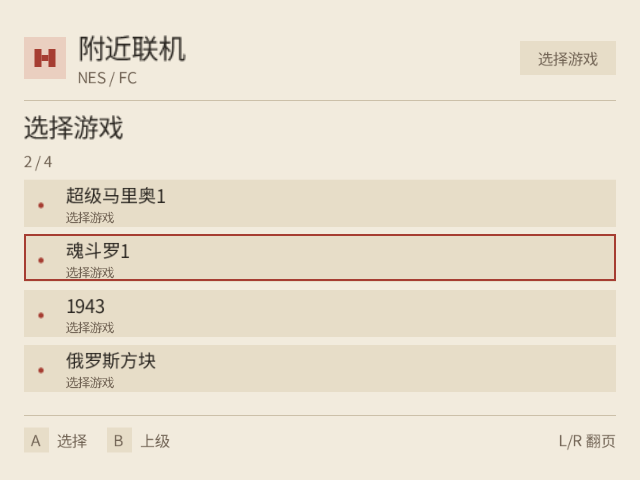
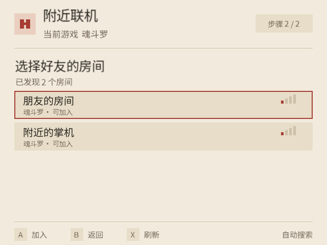
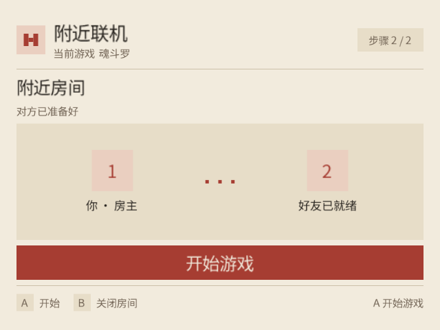
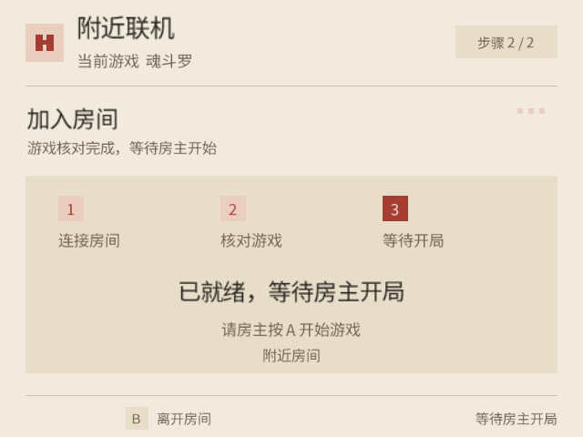

**R36S 双机附近联机**

  

选好游戏，创建房间，和身边的朋友一起玩。

[下载安装](https://github.com/W-Mai/arkos-nearby/releases/tag/v0.9.1) · [使用说明](docs/installation.md) · [游戏兼容性](docs/compatibility.md) · [源码构建](docs/building.md)

## 附近联机

ArkOS Nearby 用 Wi-Fi Direct 连接两台 R36S。中文图形界面支持手柄操作，从选择房间到开始游戏，都可以在掌机上完成。

- **当前游戏直接联机** — 在游戏列表选好游戏，启动时按住 X，搜索附近房间或创建当前游戏的房间。
- **从游戏库挑选** — 在 Options → Nearby Multiplayer → 选择游戏 中选择平台和游戏。
- **个人启动器** — 从 Options → Nearby Launcher 打开收藏，短按 X 启动单机，长按 X 打开当前游戏的联机面板。
- **收藏与搜索** — 按 X 收藏游戏，在收藏夹横向浏览卡带，按 Y 切换名称／最近使用排序。在平台列表按 Y 搜索游戏名、文件名或中文名拼音。
- **仅组网** — 连接后返回系统，打开 Ports 中的局域网游戏。
- **搜索身边的房间** — 打开工具即可搜索，选中房间后加入，按 X 刷新列表；主页按 FN + X 快速打开。
- **记住常玩的朋友** — 首次连接由房主确认，之后使用保存的配对信息。
- **8-bit 音效** — 选中、确认、发现房间和准备完成时播放对应提示音。
- **玩完回到游戏列表** — 退出游戏后恢复之前连接的 Wi-Fi。

## 安装

适用配置：**ArkOS4Clone 08262026 · Linux 4.4.189 · RTL8188EU 无线芯片 · 640×480 屏幕**。详细要求见 [设备兼容性](docs/compatibility.md#设备配置)。在两台掌机上安装同一版本：

1. 下载 [ARM64 安装包](https://github.com/W-Mai/arkos-nearby/releases/download/v0.9.1/arkos-nearby-0.9.1-arm64.tar.gz)。
2. 解压，将 `arkos-nearby` 文件夹放入游戏卡的 `ports` 目录。
3. 在掌机 **Ports** 中打开 **Install Nearby Multiplayer**，安装完成后重启掌机。

[安装说明](docs/installation.md) 提供 SSH 安装、更新和卸载命令。

## 一起玩

从 **Options → Nearby Multiplayer** 或系统主页 **FN + X** 打开工具，查看附近房间。向下移动或按 **R** 展开「仅组网／选择游戏」，向上移动或按 **L** 展开房间列表。收起的区域会保留为微缩预览。也可以从游戏列表启动时按住 **X**，直接进入当前游戏的「创建房间／加入房间」。

一台选好游戏并创建房间，另一台选中该房间后按 **A** 加入。首次连接时，房主按 **A** 确认。当前游戏匹配时自动继续；需要换游戏时，会列出本机的对应版本。选择后完成核对，房主在「对方已准备好」时选择 **开始游戏**。

需要在游戏内选择双人或连接线模式的游戏，进入游戏后继续选择对应模式。准备期间按 **B** 可以取消或离开房间。

| 方向键 | A | B | X | Y | L / R |
| :---: | :---: | :---: | :---: | :---: | :---: |
| 移动焦点 | 确认 | 返回／离开 | 刷新房间列表 | 入口页切换主题 | 游戏列表翻页 |

在选择模式或创建／加入房间的入口页按 **Y**，可依次切换松林、落日和夜营主题，重新打开时保留所选配色。

## 启动器

从 **Options → Nearby Launcher** 打开个人收藏，首页只显示收藏卡带。选中收藏末尾的游戏库图标，按 **A** 展开游戏库，收藏架保留在上方。**B** 逐级返回收藏，**SELECT** 打开附近联机。游戏库展示有游戏的平台和文件夹，提供主机图案、截图与最近游玩记录；在平台列表按 **Y** 搜索游戏。

收藏卡带按可用空间排成一排或两排，封面铺满卡带画面。左右选择同排游戏，上下切换行；在一排的边缘继续按左右可翻页。进入游戏库再返回会保留原来的选中卡片。

选中游戏后，短按 **X** 并松开启动单机，长按 **X** 弹出这款游戏的联机面板。在游戏库或搜索结果中按 **Y** 收藏，收藏架中按 **Y** 切换名称／最近游玩排序。**A** 打开游戏操作，可以将游戏移出收藏。单机使用系统原来的模拟器配置和存档，退出后回到刚才的位置。

**START** 打开设置面板，可切换主题、音效，管理直连网络，或选择「返回原系统」退出启动器。保留直连网络时，启动单机可以选择继续保持连接或先恢复 Wi-Fi。

## 仅组网

进入 **Options → Nearby Multiplayer → 仅组网**，一台创建房间，另一台选中房间加入。连接完成后，两台按 **A「保持连接，返回系统」**，再启动支持局域网联机的游戏，在游戏内创建或查找房间。

再次打开 Nearby Multiplayer 可以查看连接和设备地址，按 **B「断开并恢复 Wi-Fi」** 结束组网。

  

## 双机实拍

  
  
双方就绪，等待开始游戏

<table>
  <tr><td align="center"><b>搜索房间</b></td><td align="center"><b>坦克大战</b></td></tr>
  <tr><td></td><td></td></tr>
</table>

  
  
俄罗斯方块

界面预览

  

<table>
  <tr><td align="center"><b>选择游戏</b></td><td align="center"><b>搜索房间</b></td></tr>
  <tr><td></td><td></td></tr>
  <tr><td align="center"><b>房主开始游戏</b></td><td align="center"><b>加入者等待开局</b></td></tr>
  <tr><td></td><td></td></tr>
  <tr><td align="center" colspan="2"><b>仅组网连接完成</b></td></tr>
  <tr><td colspan="2" align="center"></td></tr>
</table>

## 文档

[安装与更新](docs/installation.md) · [平台与游戏](docs/compatibility.md) · [问题排查](docs/troubleshooting.md) · [从源码构建](docs/building.md)

应用源码采用 [MIT](LICENSE)，组件许可证和来源见 [第三方组件](docs/third-party.md)。
