# ArkOS Nearby 0.10.0

- 改善个人收藏、游戏库和联机面板的浏览响应。
- 优化截图加载与复用，预加载可见收藏和相邻游戏的画面。
- 修正切换游戏和返回页面时，收藏标题、卡带画面的更新。
- 更新时保留已安装的 GPU 渲染配置。

## 安装与更新

下载 **arkos-nearby-0.10.0-arm64.tar.gz**，解压后将 `arkos-nearby` 文件夹放入游戏卡的 `ports` 目录，在掌机 **Ports → Install Nearby Multiplayer** 中安装。两台掌机安装同一版本，安装完成后重启掌机。

适用配置：**ArkOS4Clone 08262026 · Linux ARM64 4.4.189 · RTL8188EU · 640×480 屏幕**。

[安装与更新](https://github.com/W-Mai/arkos-nearby/blob/v0.10.0/docs/installation.md) · [游戏兼容性](https://github.com/W-Mai/arkos-nearby/blob/v0.10.0/docs/compatibility.md)
